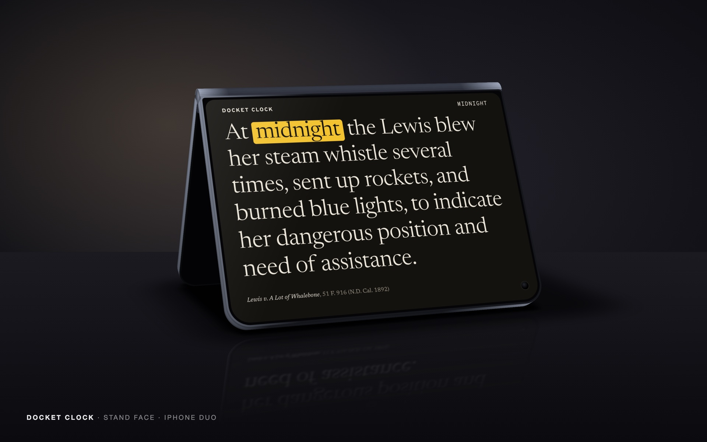
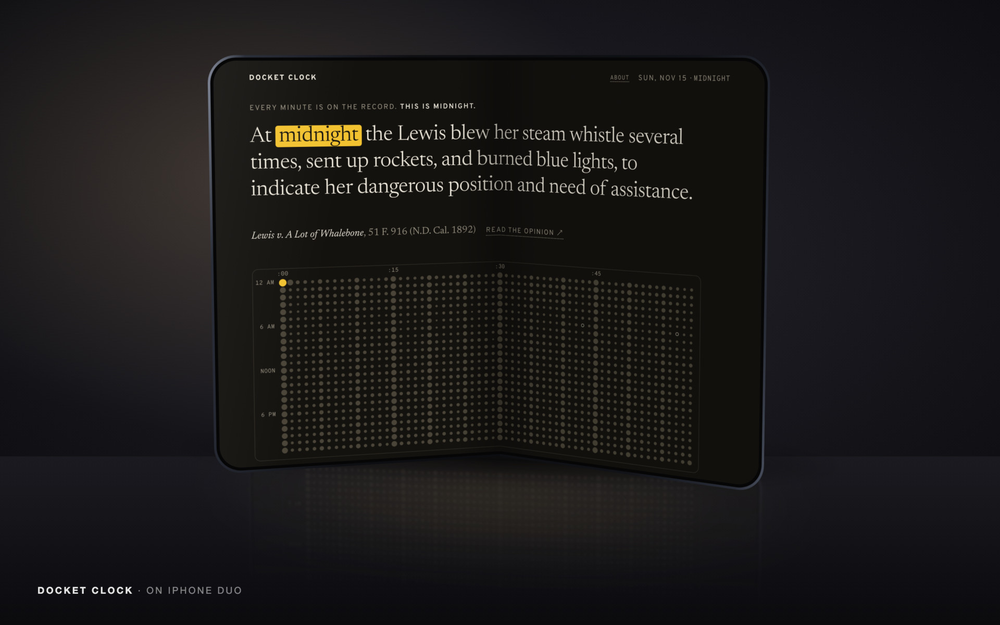
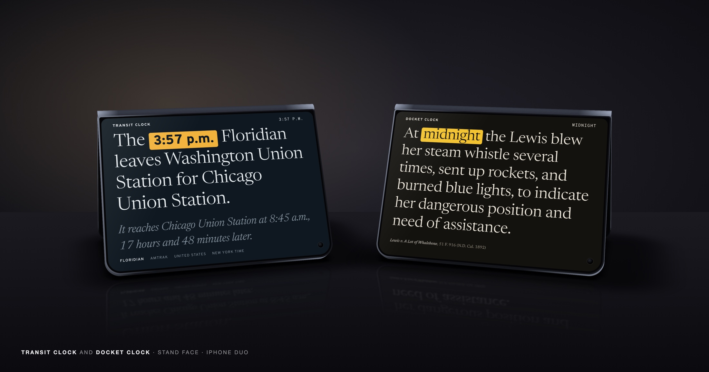

# Docket Clock

A clock made of court opinions. For every minute of the day it shows one
sentence from a real, published American court opinion that names that exact
minute.

> At **midnight** the Lewis blew her steam whistle several times, sent up
> rockets, and burned blue lights, to indicate her dangerous position and need
> of assistance.
>
> *Lewis v. A Lot of Whalebone*, 51 F. 916 (N.D. Cal. 1892)

Once GitHub Pages is switched on for this repository, the clock lives at
https://zula-root.github.io/Docket-Clock/.



*The clock's stand face on a folded iPhone Duo. A rendering, not a photograph.*

## Where the idea comes from

The [literary clock](https://literature-clock.jenevoldsen.com/) tells the time
with sentences from novels: at 4:12 you read a line of fiction that happens to
mention 4:12. It began in 2011, when the Guardian asked its readers to send in
quotations. Jaap Meijers put the list on an old Kindle, and Johannes
Enevoldsen made the web version.

This is the same clock built from a different library. A courtroom is the one
place where people are made to say exactly what time it was, so the law
reports are full of minutes: when the alarm went off, when the jury came back,
when the fax arrived. The opinions are public and in the public domain.

## What is on the page



*The whole page, on the same phone opened like a book. Also a rendering.*

- **The sentence**, quoted as the court wrote it, with the time under a stroke
  of highlighter.
- **The citation**, and a link to the full opinion.
- **The day**, drawn as 1,440 dots: sixty minutes across, twenty-four hours
  down. A bigger dot is a minute that turns up more often. An empty ring is a
  minute no opinion mentions.

Tap a dot to read that minute. The arrow keys step through the day, and
Escape comes back to now.

## What the day looks like on the record

About 145,000 sentences that name a time were found in roughly 7,800 volumes
of opinions. A few things show up as soon as they are laid out on the grid.

- **People testify in round numbers.** Half of all the times are on the hour.
  Nine in ten are on a multiple of five minutes. The vertical stripes on the
  grid are the hour, the quarters and the half.
- **The exception is 12:01 a.m.** It is by far the most common odd minute,
  because it is when statutes take effect and deadlines begin.
- **Night and day sound different.** After midnight the sentences are patrol
  cars, burglar alarms and telephone calls. In office hours they are filings,
  faxes and juries sending out notes.
- **Two minutes have never come up:** 6:43 a.m. and 6:57 a.m.

## What is left out

The record is mostly made of bad days, and a clock should not be. So:

- Sentences about violence, injury, illness, sex or children are not shown.
  Neither are slurs, or the racial descriptions old police reports are full of.
- Cases known for a killing are left out altogether, even where the sentence
  itself is harmless.
- One sentence is shown per minute, and every one of them was read before it
  went in. 366 that passed the automatic rules were taken out by hand; their
  ids are in [build/removed.txt](build/removed.txt).
- Fifteen minutes appear in the record only in sentences like that. The clock
  leaves them empty and says so.

Every sentence is in [build/shown.txt](build/shown.txt), in clock order. If one
of them should not be there, please open an issue.

The text comes from scanned books, so there is the occasional typo in a quote.
The words are otherwise the court's own.

## Put it on a phone, a tablet or a foldable

The page is built to be left running on a stand. The **Add to your device**
button at the top of the page gives the steps below for whichever device it is
opened on.

**iPhone or iPad**

1. Open the clock in Safari.
2. Tap Share, then **Add to Home Screen**.
3. Open it from the new icon. It runs full screen, without Safari's bars.
4. Stand the device up and plug it in.

The page asks the device to keep the screen on while it is open. If yours
still dims, set Settings, Display & Brightness, Auto-Lock to Never while it is
on the stand.

**A foldable, such as iPhone Duo**

Follow the same steps. Then fold the phone into a tent with the outer screen
facing you, or stand it open like a book.

On a small, wide screen the clock switches to its **stand face** by itself:
only the sentence, set as large as will fit, its citation, and the time in the
corner. That is the picture at the top of this page. A phone turned on its
side does the same.

This is the page running full screen. It is not iOS StandBy, which only shows
widgets from installed apps and so cannot show a web page.

**Android**

Open the clock in Chrome, then choose **Add to Home screen** or **Install app**
from the menu.

Two options go on the end of the address:

| Add this | What it does |
| --- | --- |
| `?theme=dark` or `?theme=light` | Holds one theme whatever the device is set to. Dark suits a bedside. |
| `?at=02:14` | Holds the clock at one minute, to share a single sentence. |
| `?face=stand` | The stand face on any screen. `?face=full` keeps the whole page. |

## Run it locally

The page loads its data with `fetch`, so serve the folder instead of opening
the file:

```
python3 -m http.server
```

Then open http://localhost:8000.

## How the data is made

Nothing here needs a build step. The three scripts in `build/` only matter if
you want to make the data again. They use Python 3.9 or later and nothing
outside the standard library.

```
curl -O https://static.case.law/ReportersMetadata.json
mkdir work
python3 build/harvest.py ReportersMetadata.json work 13 9
python3 build/curate.py work/candidates.jsonl work/stats.json data build/removed.txt
python3 build/shown.py
```

- **`build/harvest.py`** reads volumes straight from the Caselaw Access
  Project's public files, finds sentences that name a time, and keeps only
  those. It starts with one volume from each of 401 reporters, then spends its
  time on the reporters where odd minutes keep turning up. The two numbers are
  a budget: minutes to run, and gigabytes to read.
- **`build/curate.py`** scores each sentence for how it reads on a clock and
  writes `data/`. Run it with `--show 0 24` to print its picks for reading.
- **`build/shown.py`** writes `build/shown.txt` from `data/`, so the list of
  sentences always matches the clock.

To take a sentence out, add its id to `build/removed.txt` and run the last two
commands again. `--show` prints the id beside each sentence. The clock then
picks the next sentence for that minute, or leaves the minute empty. Read the
new one before it goes out: nobody has yet.

## Files

```
index.html            the clock: markup, styles and script in one file
data/00.json … 23     one file per hour: the sentence for each minute
data/index.json       how often each minute turned up, for the grid
build/                the scripts, the removals, and every sentence shown
manifest.webmanifest  lets a phone install it to the Home Screen
icon.svg, icon-*.png  the icon
```

## Credits

- Opinions: the [Caselaw Access Project](https://case.law/) at the Harvard Law
  School Library Innovation Lab.
- The idea: the Guardian's readers, Jaap Meijers and Johannes Enevoldsen.
- Type: Newsreader, Overpass and Overpass Mono.
- A sibling: the [Transit Clock](https://github.com/zula-root/Transit-Clock),
  which tells the time with train departures.


